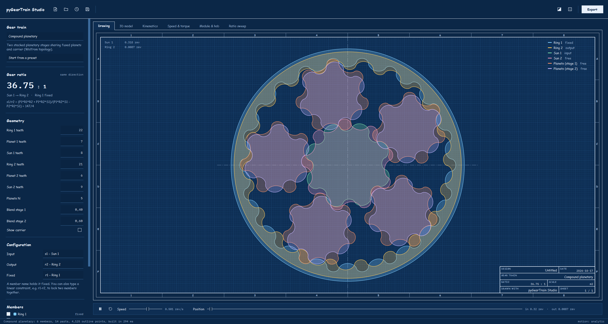
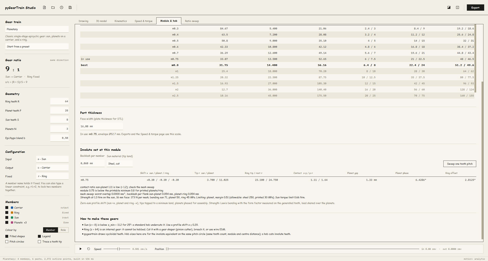
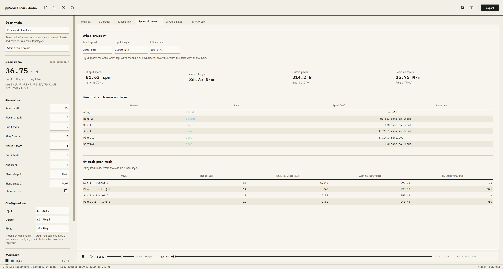
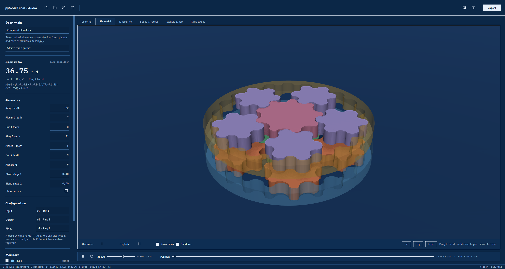
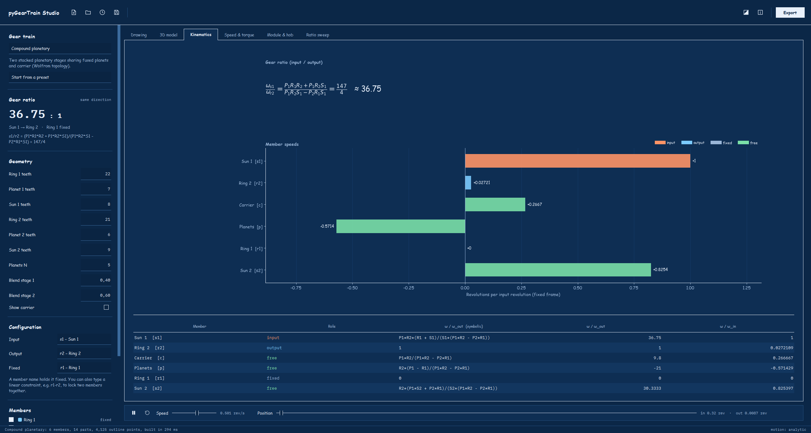
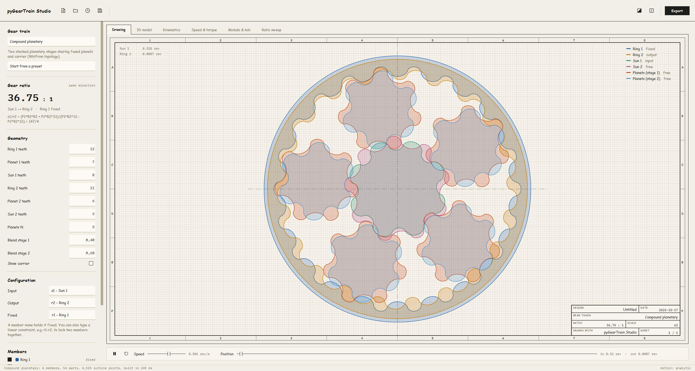

# pyGearTrain Studio

A desktop app for [pygeartrain](https://github.com/EelcoHoogendoorn/pyGearTrain) by Eelco Hoogendoorn:
design planetary, compound planetary, cycloidal and RV-style gear trains, watch them run in 2D and 3D,
size them for real manufacturing, and export them to CAD.



## Download

From the [latest release](../../releases/latest), for 64-bit Windows (no Python or installation needed):

- **`pyGearTrainStudio-<version>-win64.zip`**: unzip anywhere and run `pyGearTrainStudio.exe`.
  Starts fastest. Recommended.
- **`pyGearTrainStudio.exe`**: one portable file. It unpacks itself on every launch, so it takes a few
  seconds longer to start.

Windows SmartScreen may warn because the app is unsigned: choose *More info → Run anyway*.

## What it does

**Design**
- Seven gear trains: planetary, compound planetary (Wolfrom), cycloidal drive, compound cycloid,
  Nabtesco/RV reducer, simple pair and gerotor, with presets from pygeartrain's examples.
- Any input / output / fixed combination, or linear constraints such as `r1-r2`.
- Live checks with **one-click fixes**: ring tooth count (R = S + 2P), evenly spaceable planets,
  planets that collide.

**See it move**
- **Drawing**: the 2D view, drawn as an engineering drawing sheet, with a zoned frame, centre lines and a title block
  (design, ratio, scale, date) that also appears in exported images. Crisp, filled outlines. Zoom and pan, hover for each member's role and speed, pitch circles,
  and a fading trace of a tooth tip (epicycloids appear as it runs).
- **3D model**: GPU-rendered with metal materials, shadows and anti-aliasing. Orbit, pan and zoom; plate
  thickness; explode the stages apart; see-through ring gears.
- Both views share an exact motion model fitted to pygeartrain and checked against it, so animation
  is smooth even for 2000 : 1 trains.

**Analyse**
- **Kinematics**: the symbolic ratio as an equation and every member's speed.
- **Speed & torque**: enter input rpm, torque and efficiency to get output speed, torque and power,
  the reaction torque on the fixed member, and for every mesh its pitch-line speed, tooth-mesh
  frequency and tangential force.
- **Module & hob**: which standard module, and so which hob (m0.3, m0.4, m0.5 … m1, m1.25 …), suits
  your design:
  - fit inside a diameter, hit a centre distance (with the profile shift needed), or use a set module;
  - pitch and tip diameters of every gear, the envelope, and the DP equivalent;
  - manufacturing notes: undercut below z_min (with the profile shift that cures it), internal ring
    gears (not hobbable: shape, broach or EDM), and the non-standard module a compound's second stage
    needs, with the profile shift that keeps the shared centre distance;
  - cycloidal and gerotor designs are sized by pin-circle diameter, with the nearest ISO 2338 dowel pin.
- **Involute check** (planetary and compound planetary): the real involute set at the module in use.
  - Zero-sum profile shift, backlash thinning per member, tips topped to a minimum land, and planet
    phasing for assembly.
  - Contact ratios, neighbour-planet gap, and ring tip and root clearance.
  - Lewis bending strength with the form factor measured on the generated tooth.
  - A mesh sweep that turns the set through a tooth pitch to find overlaps and the backlash per flank.
  - Verified against a built actuator: 8/28/64, m0.75, 25°.
- **Ratio sweep**: ratio over tooth-count ranges as a curve or heatmap. Click to load a design.

**Files and export**
- Save and open designs (`*.gearstudio.json`), recent files, drag-and-drop, unsaved-changes prompts.
- **STL**: one closed mesh per part (planets once, with the count in the name) plus the assembly at
  the current position, in mm.
- **DXF** (R12, mm): the assembly with one layer per member, or the parts laid out side by side.
- **Involute gear set**: true involute sun, planet and ring as closed STL plates plus a phased DXF
  assembly, ready to print, cut or import into CAD.
- PNG of any page, GIF animation of the 2D or 3D view, and the equivalent pygeartrain script.
- Two sheets: drafting vellum (light) or cyanotype blueprint (dark), or follow Windows. Labels are
  set in Comic Sans MS (it comes with Windows; Barlow Semi Condensed is bundled as the fallback),
  numbers in IBM Plex Mono.

> **About tooth shapes.** pygeartrain draws *cycloidal* teeth, and the CAD exports contain exactly
> those. A hob cuts *involute* teeth, so the Module & hob page sizes the involute equivalent on the
> same pitch circle (same tooth count, module and centre distance).

| Module & hob | Speed & torque |
|---|---|
|  |  |

| 3D | Kinematics |
|---|---|
|  |  |



## Running from source

Windows with a [python.org](https://www.python.org/) Python 3.12:

```powershell
.\setup_env.ps1          # creates .venv with pinned dependencies
.\run_gui.bat            # or: .venv\Scripts\python -m gearstudio [design.gearstudio.json] [--tab=3d]
.venv\Scripts\python -m pytest tests
.\build_exe.ps1          # tests, then the portable folder, its zip and the single exe
```

The core (`gearstudio.model`, `sizing`, `calc`, `io`) has no UI and can be used from Python:

```python
from gearstudio.model import Scene
from gearstudio.sizing import hob_table
s = Scene('Planetary', {'R': 30, 'P': 9, 'S': 12, 'N': 3, 'b': 0.5}, ('s', 'c', 'r'))
print(s.ratio_in, hob_table(s, 20, 'od', 50).rows[0].module)

from gearstudio.involute import design_gearset, check_strength, sweep, outlines
gs = design_gearset(0.75, 8, 28, 64, 3)        # m, sun, planet, ring teeth, planets (25°, zero-sum shift)
print(gs.sun_tip_r, gs.planet_rot_deg, gs.eps_sp, sweep(gs))
```

### Layout

| | |
|---|---|
| `gearstudio/catalog.py` | gear trains: parameters, presets, checks, sizing data |
| `gearstudio/model.py` | builds a scene and fits the analytic motion of every part |
| `gearstudio/meshing.py` | closed, watertight plate meshes (caps by constrained Delaunay) |
| `gearstudio/sizing.py`, `calc.py` | module/hob sizing, profile shift, speeds and torques |
| `gearstudio/involute/` | involute geometry, planetary set design, Lewis strength, mesh sweep |
| `gearstudio/io.py` | design files, STL and DXF |
| `gearstudio/ui/` | Qt (PySide6) interface, Qt Quick 3D scene |
| `tests/` | `pytest` suite; `smoke_gui.py` drives the whole window through every preset |

### Dependency notes

pygeartrain is not on PyPI, so a copy lives in [`vendor/pyGearTrain`](vendor/pyGearTrain) (MIT, see its
LICENSE). `setup_env.ps1` handles its dependencies:

- `numga` is pinned to the last commit before its 2.0 rewrite, which removed the API pygeartrain uses.
  That version needs numpy 1.x, so scipy and matplotlib are pinned to match.
- `pycomplex` needs `fastcache` and `pycosat`, which need a C compiler on Windows. `fastcache` is
  replaced by a `functools.lru_cache` shim. `pycosat`, which is only used for 3D mesh orientation, is
  replaced by a stub.
- Mesh caps use `shapely.constrained_delaunay_triangles` (Shapely 2.1 or newer).

## License

MIT. pygeartrain is © Eelco Hoogendoorn, also MIT. Qt / PySide6 are used under the LGPL v3. The bundled
fonts [Barlow](https://github.com/jpt/barlow) and [IBM Plex Mono](https://github.com/IBM/plex) are under the
SIL Open Font License (see `gearstudio/ui/fonts`).
