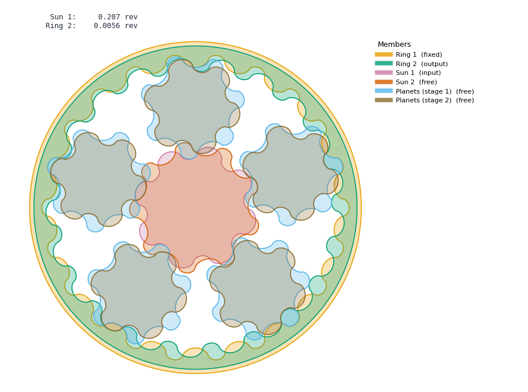
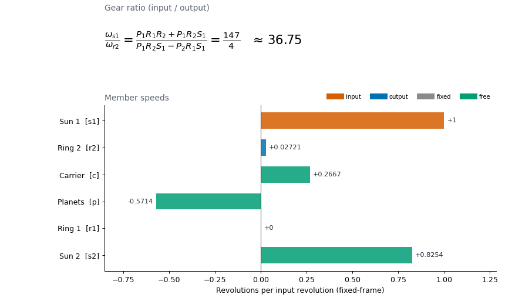
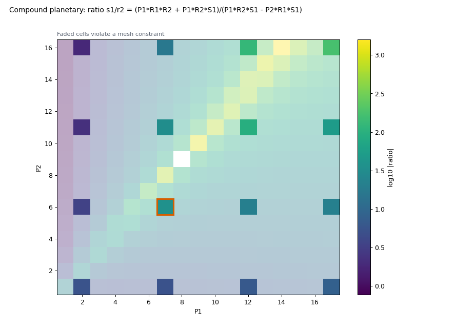
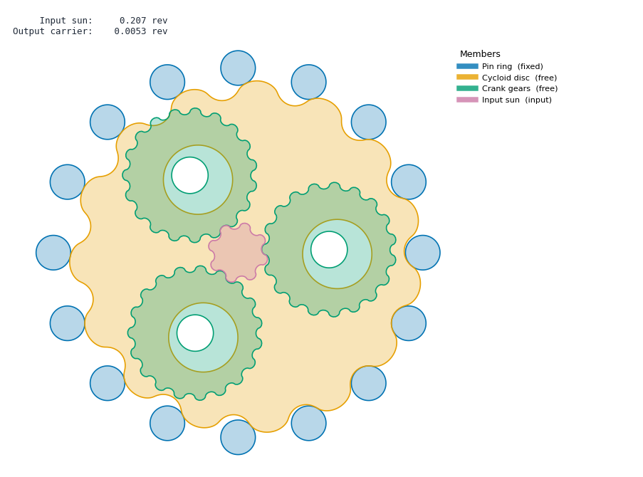
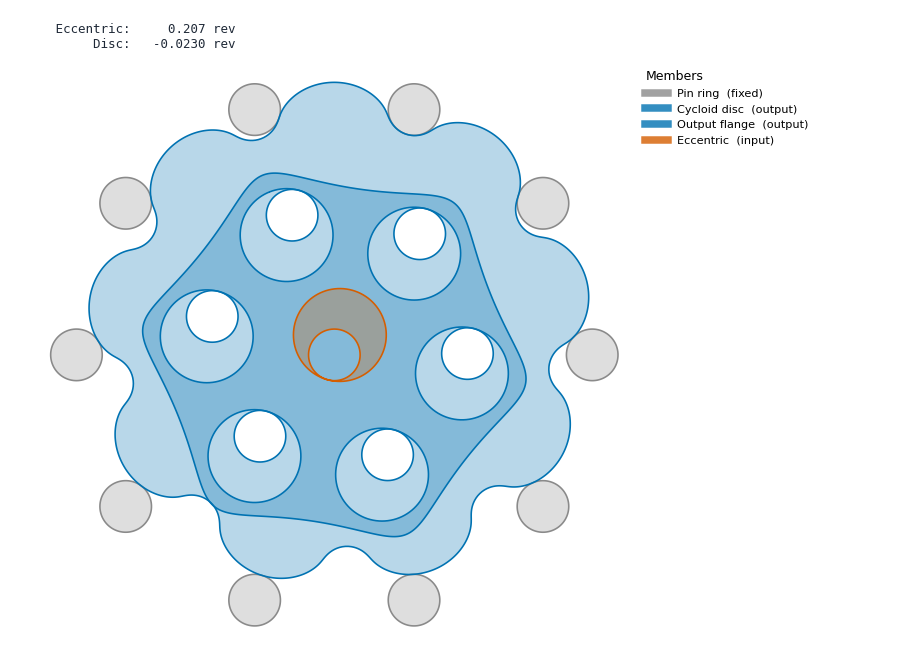

# pyGearTrain Studio

A desktop GUI for [pygeartrain](https://github.com/EelcoHoogendoorn/pyGearTrain) by Eelco Hoogendoorn:
build planetary, compound planetary, cycloidal and RV-style gear trains, watch them run, and explore
their kinematics.



## Download

Grab `pyGearTrainStudio.exe` from the [latest release](../../releases/latest). It is a single portable
file for 64-bit Windows; no Python or installation needed. Startup takes a few seconds while it unpacks.
Windows SmartScreen may warn because the exe is unsigned: choose *More info → Run anyway*.

## Features

- **Seven gear trains**: planetary, compound planetary (Wolfrom), cycloidal drive, compound cycloid,
  Nabtesco/RV reducer, simple gear pair and nested gerotor, with presets taken from pygeartrain's examples.
- **Any configuration**: choose input, output and fixed members, or type a linear constraint such as
  `r1-r2` to fuse two members.
- **Live animation** with filled profiles, colouring by member or by role (input / output / fixed / free),
  speed control, a position scrubber and revolution counters.
- **Kinematics view**: the symbolic gear ratio rendered as an equation, a speed bar chart and a table of
  every member's ratio.
- **Ratio sweep**: 1D plots or 2D heatmaps of the ratio over tooth-count ranges, with geometrically
  invalid combinations faded out. Click a cell to load it.
- **Meshing checks** (e.g. R = S + 2P, evenly spaceable planets).
- **Export** PNG frames and GIF animations, or copy an equivalent pygeartrain script to the clipboard.

| Kinematics | Ratio sweep |
|---|---|
|  |  |

| Nabtesco / RV | Cycloidal drive, coloured by role |
|---|---|
|  |  |

## Running from source

Windows with a [python.org](https://www.python.org/) Python 3.12 (Anaconda's Python works for running,
but not for building the exe):

```powershell
.\setup_env.ps1     # creates .venv with pinned dependencies
.\run_gui.bat       # or: .venv\Scripts\python geartrain_gui.py
.\build_exe.ps1     # optional: builds dist\pyGearTrainStudio.exe
```

### Dependency notes

pygeartrain is not on PyPI, so a copy lives in [`vendor/pyGearTrain`](vendor/pyGearTrain) (MIT, see its
LICENSE). Its dependencies need some care, all handled by `setup_env.ps1`:

- `numga` is pinned to the last commit before its 2.0 rewrite, which removed the API pygeartrain uses.
  That version requires numpy 1.x, so scipy and matplotlib are pinned to matching releases.
- `pycomplex` depends on `fastcache` and `pycosat`, which need a C compiler on Windows. `fastcache` is
  replaced by a one-line `functools.lru_cache` shim, and `pycosat` (only used for 3D mesh orientation)
  by a stub.

## License

MIT. pygeartrain is © Eelco Hoogendoorn, also MIT.
